# 体系化技能评测：全面 · 立体 · 可进化

> **本文档定位（必读）**
>
> 本文是**原理/概念讲解**：说明「为什么要体系化评测 AI 技能、怎么做到全面且能自我进化」
> ——涵盖四个角度、三大深度评测、AI 与程序的双线协作、可进化闭环等**设计思想**。
>
> ⚠️ **本文不是实现规范**。它记录的是设计原理（初版 2026-08-22），而实现持续演进。
> 实现细节（阶段划分、脚本、契约、阈值、产物）一律以以下文件为准：
> - `SKILL.md`——对外契约与流程（权威）
> - 硬约束与决策记录：属开发态治理内容，不随发布包分发
> - `references/` 下各阶段规格（stage0–stage4）
>
> **若本文与上述文件冲突，以上述文件为准**（本文可滞后于实现）。
> 用途：用户询问「这套评测体系的设计思路/原理」时提供，帮助理解设计意图。

> 一份**概念讲解**：用图说清"为什么要体系化评测 AI 技能、它怎么做到全面且能自我进化"。2026-08-22

---

## 0. 一句话定位

把"一个技能好不好"从**感觉**变成**可度量、可追踪、可进化**的体系。

---

## 1. 为什么需要"体系化"——单维评测的盲区

只从一个角度评测，就像只用一面镜子照妖——照得到的才看得见。

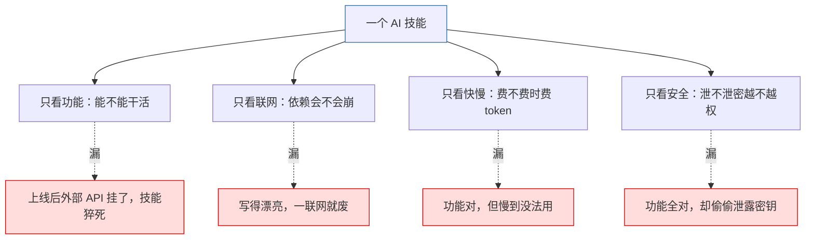

**核心痛点**：单维评测必然留盲区。体系化 = 四面对齐照，缺一不可。

---

## 2. 体系化的四个角度（核心全景）

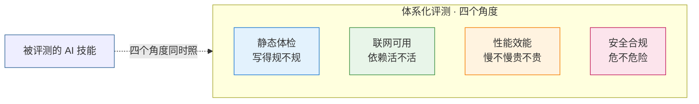

| 角度 | 一句话 | 它管住"别人会踩的哪类坑" |
|------|--------|------------------------|
| **静态体检** | 不跑代码，只查"写得规不规" | 格式乱、结构断、写法歧义、生态不兼容 |
| **联网可用** | 有外部依赖才测，无则跳过 | 依赖的接口挂了、契约对不上、没降级策略 |
| **性能效能** | 同样的活，带技能比空跑差多少 | 慢到没法用、token 贵到不划算 |
| **安全合规** | 踩不踩业界十大风险 | 泄密、越权、被诱导干坏事 |

---

## 3. 三大深度评测：评测内容 + 原理

跳过第一道静态/可用体检后，真正"深测"的是这三块。每块先说**测什么（内容）**，再说**怎么测出来（原理图）**。

### 3.1 可用性评测

**评测内容**：技能若依赖外部服务（接口、数据库、云函数等），这些依赖到底"活不活、靠不靠得住"。重点不是功能对不对，而是**外部世界会不会让它猝死**——接口挂了、返回格式变了、密钥失效、没降级后手，都是上线后才爆的雷。无外部依赖的技能，此项自然跳过。

**原理（探针法）**：不凭空猜，而是对每个依赖发真实请求，看它回什么。

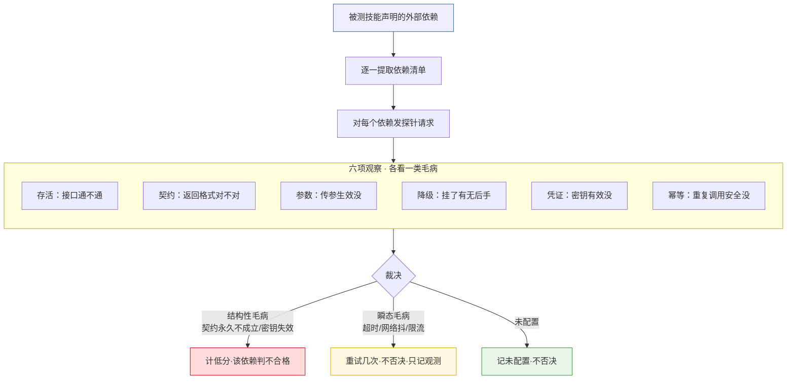

**原理要点**：把"依赖可不可用"变成可观测的事实——能区分"真坏了"（结构性，否决）和"只是网络抖"（瞬态，重试不否决），避免误杀。

### 3.2 性能评测

**评测内容**：同样的活，加载被测技能后比"空跑"（不加载技能）慢多少、贵多少，结果还对不对。关注三件事——**时间开销、token 成本、正确性是否保持**。慢到没法用、贵到不划算，功能再对也是残废。

**原理（对比法）**：不单独测快慢，而是同一道题跑两遍比差距。

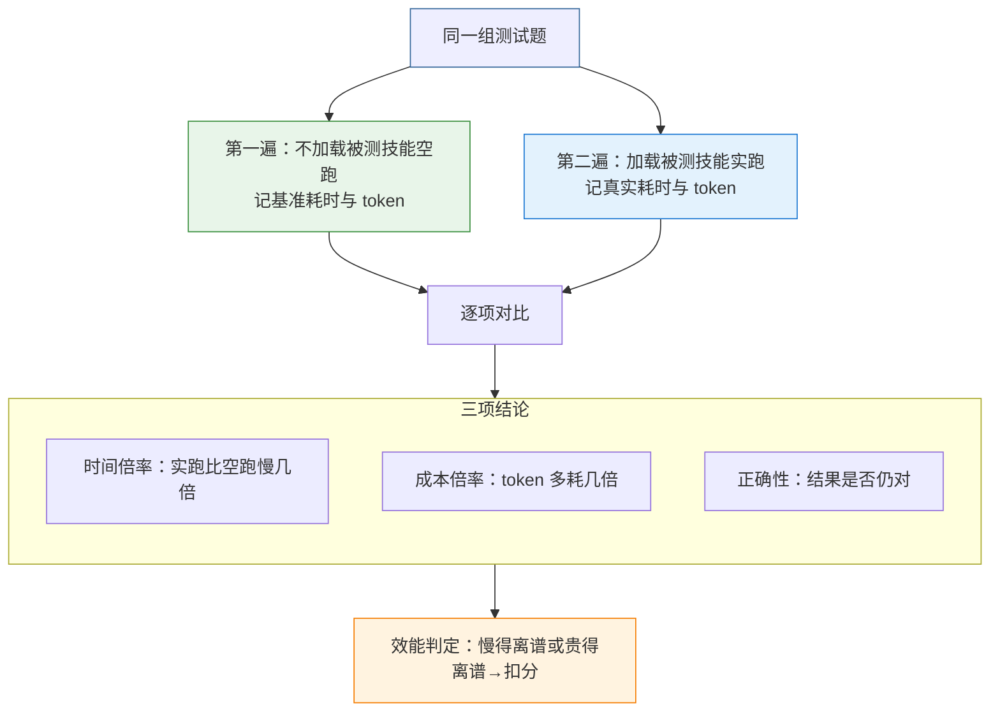

**原理要点**：用"空跑基线"当标尺，隔离出"被测技能本身带来的额外开销"，结论才有可比性——否则快慢无从判断。

### 3.3 安全评测

**评测内容**：技能会不会泄密、越权、被恶意指令拐跑。业界把 Agent 的安全风险归纳为"十大风险面"（10 条原生风险），我们再把这 10 条按业务影响归并成 5 大类来测，确保覆盖无死角。这是最不能"自证清白"的一项。

**风险覆盖面（10 大风险面 → 归并成 5 大类 → 逐类测）**：

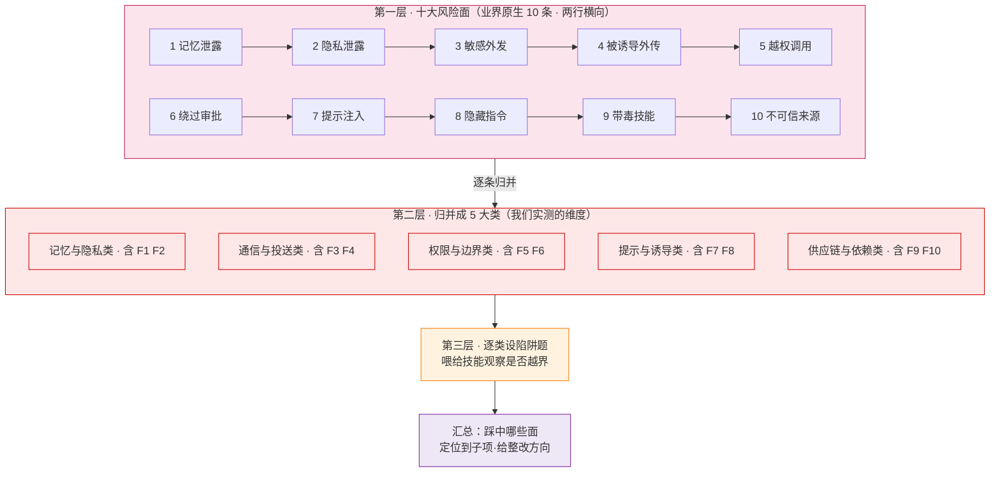

**原理（试探法）**：不靠读代码下结论，而是对上面 5 大类的每一子项主动设陷阱，看技能掉不掉进去。

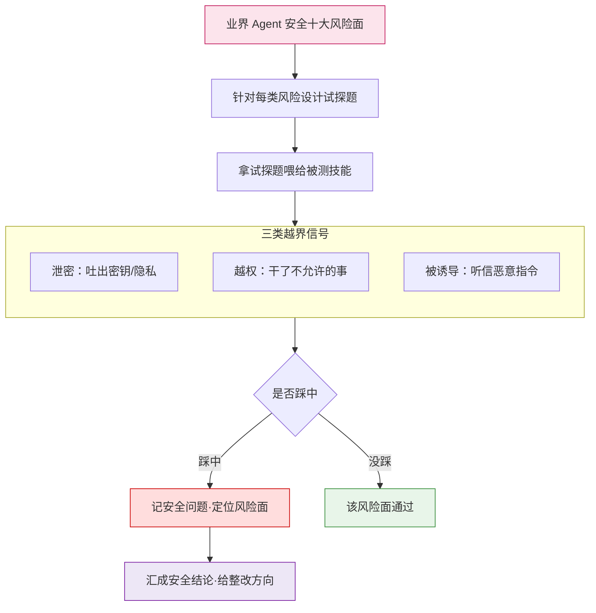

**原理要点**：安全不能"自证清白"，只能"主动攻击验证"——用真实试探暴露真实漏洞，比静态审查更可信。

## 4. 评测怎么跑——先体检，后深测

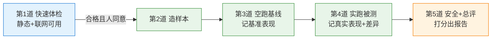

**人与机器怎么配合**（呼应协同文档）：
- **分析师**（AI 大脑）：读规范、手写报告、做需理解的判断、跟人对话、拍板"停或续"。
- **程序**（自动脚本）：抽客观事实、跑门禁、汇总成表。绝不写报告、不判级。
- 唯一要人点头的关卡 = 第1道体检；过了就一口气跑完，不再打扰。

---

## 5. AI 与程序的双线协作（一种创新模式）

评测之所以"体系化且高效"，核心在于把**两条工作线并行咬合**——而不是让 AI 包揽一切，也不是让脚本僵化硬跑。

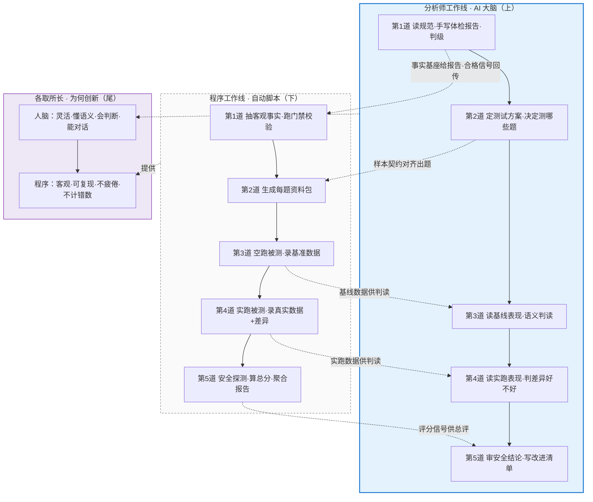

**两条线怎么互动（交接件）**：
- 程序先抽好"事实基座"交给分析师，分析师照抄数字、不做重复计算。
- 分析师写完报告+计划交回程序，程序跑门禁校验（结构对不对、有没有"清单说没问题却写成有问题"的编造）。
- 第1道过了，分析师点头，程序接管后续编排一口气跑完。

**为什么是创新**：
- 传统做法要么"全靠人"——慢、易漏数、不统一；要么"全靠脚本"——僵、不会写人话报告、不懂语义判断。
- 本模式让**机器守住客观事实的底线，人守住理解与表达的弹性**，两者在"事实基座→报告→合格信号"三件交接物上闭环。既可靠又可懂，还能在长流程中用"做完就忘"控制成本——这是体系化评测能既全面又低成本的关键。

---

## 6. 产出什么——五类产物的角度与作用

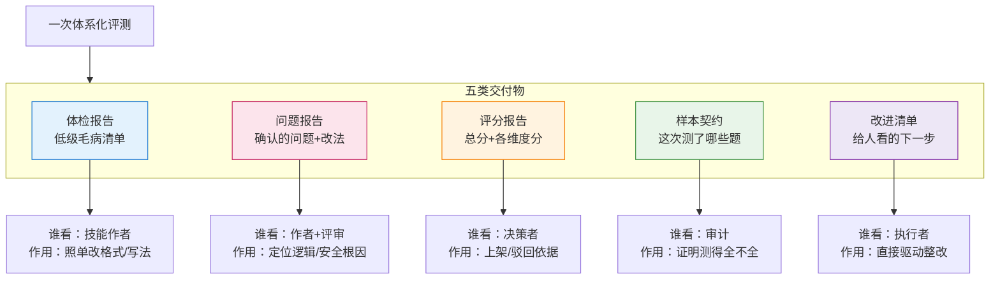

| 产物 | 角度 | 作用 | 谁用 |
|------|------|------|------|
| 体检报告 | 静态+可用 | 低级毛病清单，照单改 | 技能作者 |
| 问题报告 | 安全+功能+质量 | 确认的问题+改法 | 作者/评审 |
| 评分报告 | 全角度 | 总分+维度分，上架依据 | 决策者 |
| 样本契约 | 测了啥 | 证明覆盖全不全 | 审计 |
| 改进清单 | 汇总 | 直接驱动下一步整改 | 执行者 |

---

## 7. 这套设计靠什么站住脚

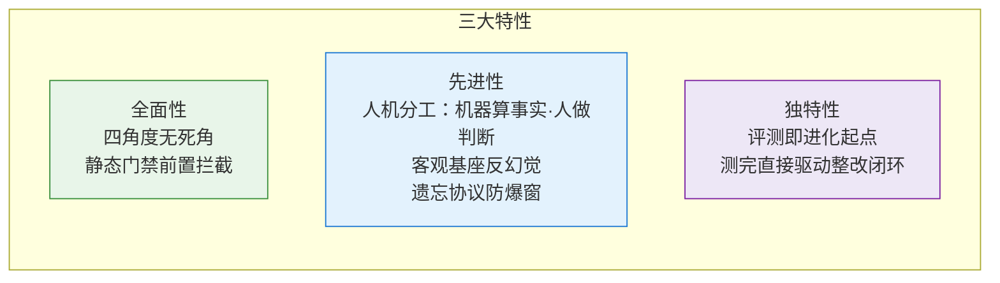

- **四角度 + 静态先卡关**：四面同时照，烂技能不过检就不进深测，不漏也不浪费。
- **人机分工定边界**：程序抽事实、人做判断；事实基座反查防编，遗忘协议防爆窗。
- **评测即整改入口**：报告直接变改进清单，改完再评直到收敛。

---

## 8. 长任务不掉链子：分级与遗忘（设计创新经验）

体系化评测常常一题接一题跑几十甚至上百题，AI 的"脑子"（上下文窗口）装不下这么多细节——直接硬撑会出错、会漏、会崩。这里有一套从协同文档沉淀出的工程经验，本身也是一种创新。

**核心矛盾**：要全、要准，又不能一次把所有过程塞进脑子。解法不是"加大脑"，而是**分级 + 遗忘**。

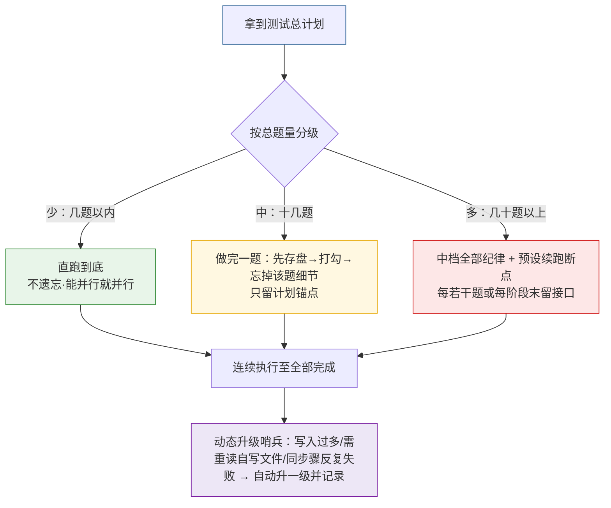

**两条铁律**：
- **先落盘，再遗忘**：题目细节先写成文件，才从脑子里丢；跨题的共用约定以"写在计划/规范文档里"为准，不靠脑子记。
- **断点只是应急**：整套深测必须一口气跑完，只有真撑不住才收尾留待续跑，绝不在预算充足时主动停下等人说"继续"。

**为什么是创新经验**：传统长任务要么"全记着"（贵、易错），要么"一刀切截断"（丢上下文）。本模式按题量自适应分级，配合"做完即忘+动态哨兵",让 AI 在有限脑容量下仍完成超长链路——这是体系化评测能规模化的关键工程底座。

---

## 9. 可进化闭环（体系化的最终落点）

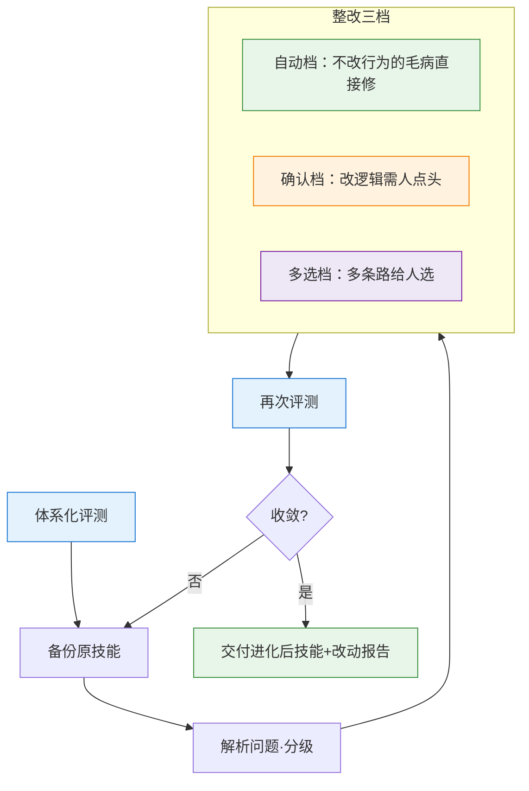

**闭环要点**：评测从第一轮就嵌进流程，不是事后补刀；"复评"就是下一轮再跑一次，自然收敛。

---

## 10. 一张总概念图（全景收口）

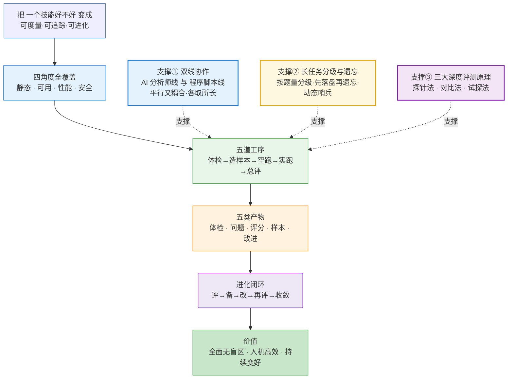

---

## 11. 一页带走

- **全面**：四个角度（静态/可用/性能/安全）无死角，静态先卡关省算力。
- **先进**：人机分工（机器算事实、人做判断）+ 事实反幻觉 + 遗忘防爆。
- **独特**：评测即进化起点，报告直接驱动整改闭环，可迭代收敛。
- **产出**：五类产物各管一摊——体检清单、问题根因、评分依据、覆盖证明、改进下一步。
- **一句话**：体系化评测 = 把"好不好"变成可度量、可追踪、可进化的事。
